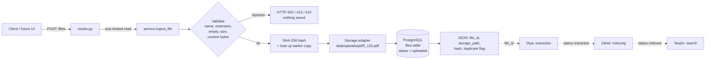
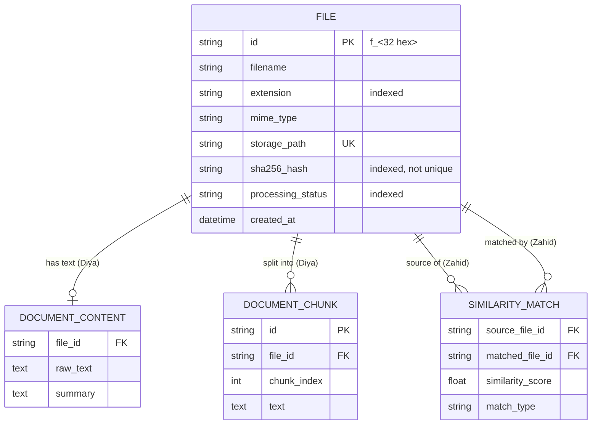

# Ingestion and Storage Module

**Owner:** Tahmid · **Branch:** `feature/ingestion-storage` · **Code:** `app/ingestion/`, `app/shared/models/file.py`, `app/shared/storage/`

This module is the entry point of the whole pipeline. It answers three questions for the rest of the team: how does a file enter the system, where is the original saved, and what ID does everyone use to refer to it?

It validates each upload, checks that the file's content really matches its extension, computes a SHA-256 fingerprint, saves the original under a folder for its extension, records a row in the `files` table, and returns a `file_id`. It does **not** read, summarise or embed documents: that is Diya's and Zahid's work.

---

## 1. Architecture



### Where each file lives

| Path | Purpose | Owner |
|---|---|---|
| `app/ingestion/routes.py` | `POST /files`, `GET /files/{file_id}` | Tahmid |
| `app/ingestion/service.py` | Upload logic + functions teammates call | Tahmid |
| `app/ingestion/file_types.py` | Allowed types, filename cleaning, content check | Tahmid |
| `app/ingestion/hashing.py` | SHA-256 | Tahmid |
| `app/ingestion/schemas.py` | JSON response shapes | Tahmid |
| `app/shared/models/file.py` | `File` table + `ProcessingStatus` (shared contract) | Tahmid, team-reviewed |
| `app/shared/storage/` | Storage interface + local adapter | Tahmid |
| `app/shared/config/settings.py` | Environment settings | Shared (Tahmid added ingestion settings) |
| `app/shared/database.py` | Engine, `get_db()`, `init_db()` | Shared |
| `app/main.py` | FastAPI app, includes routers | Tanjim (minimal version provided) |
| `tests/ingestion/` | 75 automated tests | Tahmid |
| `docs/api-contract.md` | Shared contract (File section complete; other sections for their owners) | Team |
| `sample_files/ingestion/` | Sample files for demos and teammates' tests | Tahmid |

### Data model

The `File` row is the anchor every other table points to through `file_id`. Teammates' tables are shown with the fields agreed in the shared contract; they are owned and built by them.



Exact SQL for the `files` table: [`docs/sql/files_table.sql`](sql/files_table.sql).

---

## 2. API

### `POST /files`: upload one file

Multipart form upload, field name `file`.

```bash
curl -F "file=@sample_files/ingestion/ai-evolution.pdf" http://127.0.0.1:8000/files
```

**201 Created**

```json
{
  "file_id": "f_74a2502cd543454ebcf8b116b8c554e7",
  "filename": "ai-evolution.pdf",
  "extension": "pdf",
  "mime_type": "application/pdf",
  "storage_path": "data/uploads/pdf/f_74a2502cd543454ebcf8b116b8c554e7.pdf",
  "sha256_hash": "ff53469fbf54aa0fde491e21191454f390bdea7b335e8dcfee7875d0995f8406",
  "status": "uploaded",
  "is_exact_duplicate": false,
  "duplicate_of": null
}
```

When the same bytes were uploaded before, the new upload still gets its own `file_id` and its own stored copy, and the response says `"is_exact_duplicate": true, "duplicate_of": "<first file_id>"`.

**Errors** (nothing is saved to disk or database when an upload is rejected)

| Code | When | Example `detail` |
|---|---|---|
| 400 | Empty file | `The file is empty.` |
| 400 | Content does not match extension | `The file's content does not look like a .pdf file.` |
| 400 | No filename | `The upload has no filename.` |
| 413 | Larger than `MAX_UPLOAD_SIZE_MB` | `The file is larger than 26214400 bytes.` |
| 415 | Extension not allowed, or none | `.exe is not supported. Allowed: csv, docx, jpeg, jpg, pdf, png, txt, xlsx.` |
| 422 | Request has no `file` field | FastAPI validation error |

### `GET /files/{file_id}`: status and details

```json
{
  "file_id": "f_74a2502cd543454ebcf8b116b8c554e7",
  "filename": "ai-evolution.pdf",
  "extension": "pdf",
  "mime_type": "application/pdf",
  "storage_path": "data/uploads/pdf/f_74a2502cd543454ebcf8b116b8c554e7.pdf",
  "sha256_hash": "ff53469f...",
  "status": "uploaded",
  "created_at": "2026-09-27T19:06:57.619817-07:00"
}
```

Unknown ID → `404 {"detail": "No file with id f_...."}`.

---

## 3. Contract details

**Allowed types:** `pdf, docx, txt, csv, xlsx, png, jpg, jpeg` (list in `app/ingestion/file_types.py`).

**Extension:** always lower case with no dot. `REPORT.PDF` is stored as `pdf`; the original filename is kept unchanged in `filename`.

**`mime_type`:** decided by the server from the file's content, not taken from the browser.

**`storage_path`:** `<UPLOAD_DIR>/<extension>/<file_id>.<extension>`, relative to the repository root when `UPLOAD_DIR` is relative. Treat it as an opaque string and read it through the storage adapter.

**`processing_status` values** (`ProcessingStatus` in `app/shared/models/file.py`):

| Value | Set by |
|---|---|
| `uploaded` | Tahmid, on successful upload |
| `extracting` → `extracted` | Diya |
| `indexing` → `indexed` | Zahid (only after every chunk is stored) |
| `failed` | Whoever hit an unrecoverable error |

The column is a plain string, so adding a value such as `ocr_needed` only requires adding it to the enum (after team agreement), not a database migration.

---

## 4. Handoffs

### For Diya (extraction)

You need only `file_id`. Everything else comes from the row:

```python
from app.ingestion.service import get_file, update_processing_status
from app.shared.models.file import ProcessingStatus
from app.shared.storage import get_storage

record = get_file(db, file_id)             # None if the ID is unknown
data = get_storage().read_bytes(record.storage_path)
update_processing_status(db, file_id, ProcessingStatus.EXTRACTING)
# ... extract text from `data` based on record.extension ...
update_processing_status(db, file_id, ProcessingStatus.EXTRACTED)
```

Opening the bytes with common libraries, without needing a file path:

| Extension | Library | How to open `data` |
|---|---|---|
| pdf | PyMuPDF | `fitz.open(stream=data, filetype="pdf")` |
| docx | python-docx | `docx.Document(io.BytesIO(data))` |
| xlsx | openpyxl | `openpyxl.load_workbook(io.BytesIO(data), read_only=True, data_only=True)` |
| csv / txt | built-in | `data.decode("utf-8-sig")`; fall back to `"utf-16"` if it starts with `\xff\xfe`, or `"cp1252"` for older Windows files |
| png / jpg / jpeg | Pillow (for OCR later) | `PIL.Image.open(io.BytesIO(data))` |

### For Zahid (indexing and duplicates)

Exact duplicates share the same `sha256_hash`. To list earlier and later copies of a file:

```python
from app.ingestion.service import find_files_with_same_hash
copies = find_files_with_same_hash(db, file_id)   # other File rows, oldest first
```

Each copy is a candidate for a `SimilarityMatch` with `match_type="exact_duplicate"` and score `1.0`. Creating those rows is Zahid's responsibility.

### For Tanjim (integration)

1. `app/main.py` must keep `app.include_router(ingestion_router)` and call `init_db()` on startup.
2. Add the ingestion variables from `.env.example` to the team's `.env.example`.
3. Merge `requirements.txt` lines (note `python-multipart`, which FastAPI needs for uploads).
4. Docker Compose PostgreSQL service must match `DATABASE_URL` (user, password, database, port).
5. For the end-to-end test, call `POST /files` or `ingest_file()` directly, then pass the returned `file_id` to extraction.

---

## 5. Design decisions

| Decision | Why |
|---|---|
| Check the file's first bytes ("magic numbers") instead of trusting the extension or the browser's MIME type | Both are chosen by the client. Windows browsers even send `.csv` as an Excel MIME type, so rejecting on browser MIME would block valid files. Checking the bytes catches renamed files. |
| Save files as `<file_id>.<ext>`, never under the user's name | Filenames are not unique and can contain `../` path tricks. `file_id` is unique and safe. |
| One folder per extension | Meets the requirement that files are sorted by extension, and is easy to show in a demo. |
| Keep exact-duplicate uploads as separate rows | Zahid's plan records exact duplicates as a `SimilarityMatch` between two different `file_id`s, which requires both rows to exist. The response still warns the uploader. |
| `sha256_hash` indexed but not unique | Fast duplicate lookups while allowing the duplicate rows above. |
| Storage behind a small interface (`StorageBackend`) | Cloud storage can be added later by writing one class; nobody else's code changes. |
| All checks before any save; delete the saved file if the database insert fails | Disk and database never disagree, and rejected uploads leave no trace. |
| Status as a string column plus a Python enum | Typos are caught in code, while new statuses need no migration. |
| Sync route (`def`) | FastAPI runs it in a worker thread, so blocking disk and database calls are safe without async code. |
| Tables created with `create_all()` on startup | Simplest option for a course prototype. Alembic migrations can be added later if the schema starts changing often. |

## 6. Known limitations

- Only local storage is implemented. `STORAGE_BACKEND` values other than `local` raise an error.
- Two identical files uploaded at the same instant may both be marked as not duplicate; the hash still matches, so Zahid's hash check will catch them afterwards.
- Legacy formats (`.doc`, `.xls`) and other types (code files, `.md`, `.pptx`) are not accepted yet. Adding one means adding a line to `SUPPORTED_TYPES` and a content rule in `content_matches_extension()`.
- A DOCX or XLSX is recognised by its internal `word/document.xml` or `xl/workbook.xml` entry. A deliberately crafted fake could pass this check; that is acceptable for this prototype.
- Deleting uploaded files is not part of the API yet.
